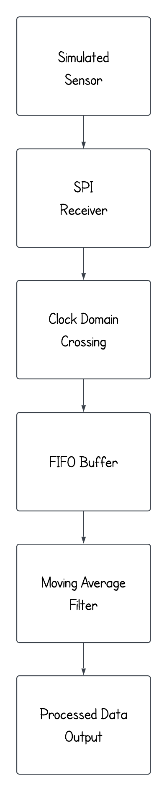
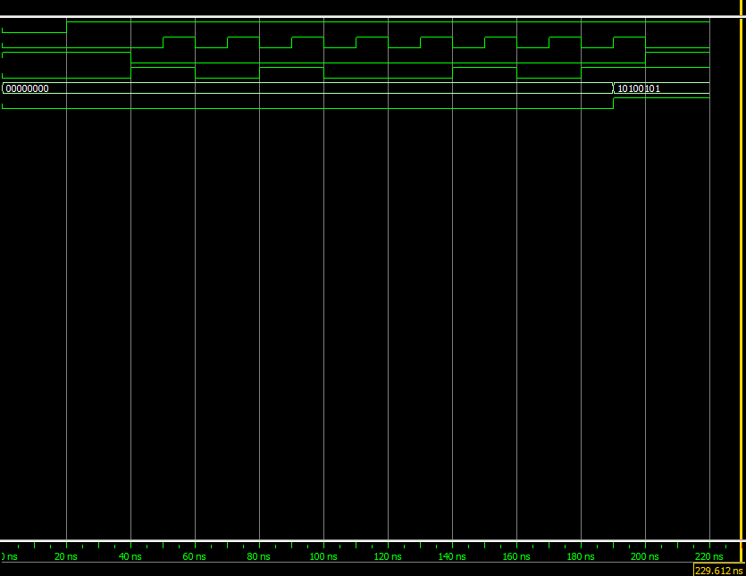
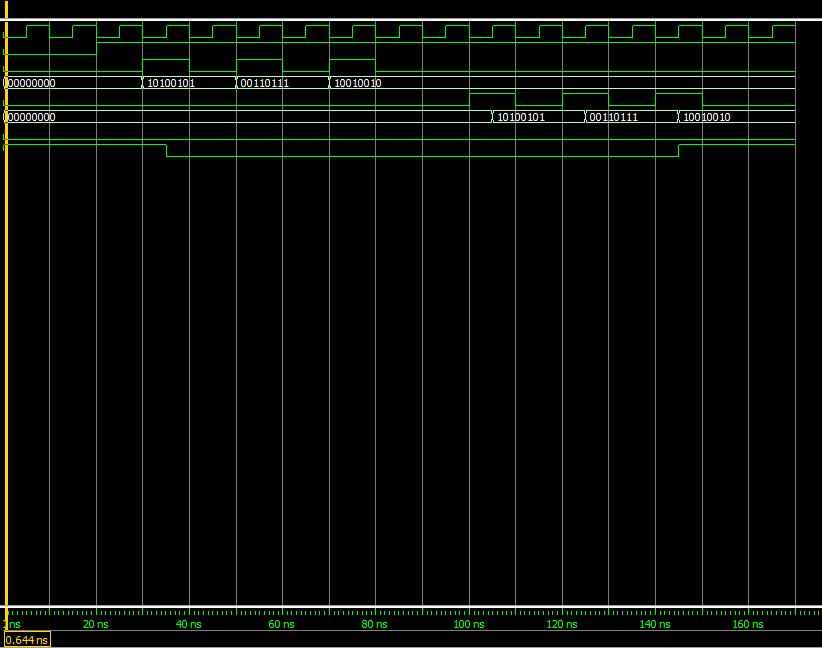
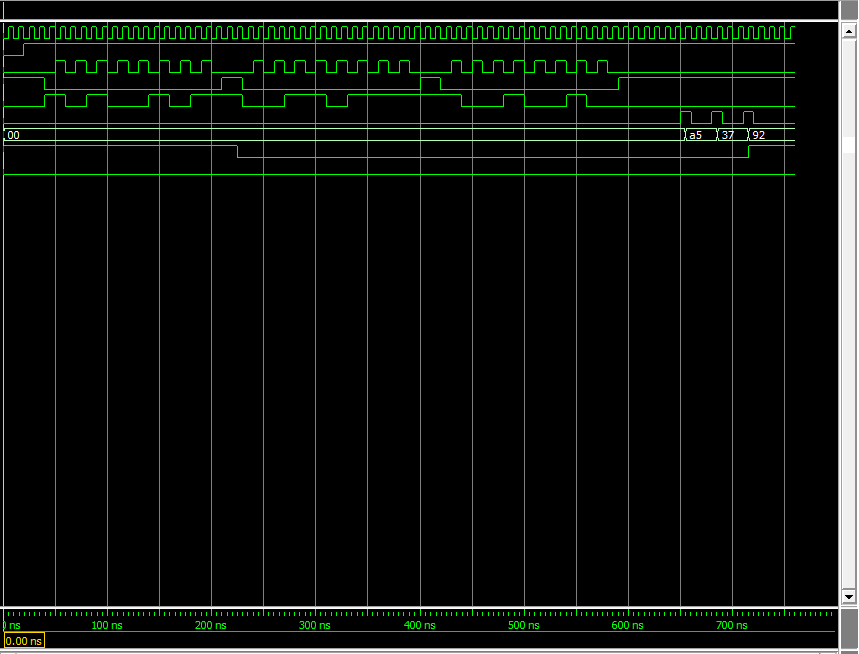
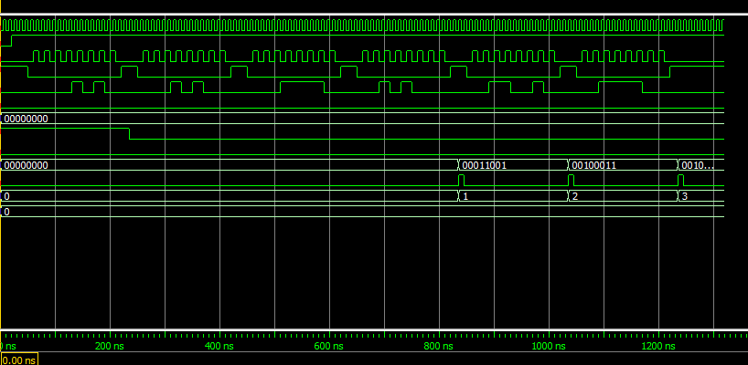

# FPGA Data Acquisition System

A SystemVerilog-based FPGA data acquisition system that receives sensor data over SPI, transfers the data between clock domains, buffers samples using a FIFO, and performs real-time moving-average processing.

The project was developed using **Intel Quartus Prime Lite** and verified using **ModelSim Intel FPGA Starter Edition**.

## Project Overview

The system models a basic FPGA-based sensor data acquisition pipeline.

Data enters the FPGA serially through an SPI interface. After a complete 8-bit sample is received, the sample is transferred from the SPI clock domain into the main system clock domain. The data is then buffered in a FIFO and processed using a four-sample moving-average filter.

### System Architecture

The following diagram shows the complete FPGA data path from the simulated sensor input to the processed output.

<p align="center">
  
</p>

## Features

- 8-bit SPI data receiver
- Clock-domain crossing between SPI and system clock domains
- FIFO-based sample buffering
- Four-sample moving-average filter
- Modular SystemVerilog design
- Individual module testbenches
- Full-system integration testbench
- Self-checking simulation
- Synthesized using Intel Quartus Prime Lite
- Verified using ModelSim

## Project Structure

```text
fpga-data-acquisition-system/
├── data_acquisition_top.sv
├── data_acquisition_top_tb.sv
├── spi_rx.sv
├── spi_rx_tb.sv
├── fifo_buffer.sv
├── fifo_buffer_tb.sv
├── moving_average.sv
└── moving_average_tb.sv
```

### `spi_rx.sv`

Receives serial SPI data from the MOSI input. After eight bits have been received, the module produces an 8-bit output sample and asserts a `data_valid` signal.

### `fifo_buffer.sv`

Buffers received sensor samples before they are read by downstream logic. The FIFO provides `full` and `empty` status signals to control reads and writes.

### `moving_average.sv`

Implements a four-sample moving-average filter. Once four samples are available, the module calculates:

```text
average = (sample0 + sample1 + sample2 + sample3) / 4
```

As new samples arrive, the oldest sample is removed from the window.

### `data_acquisition_top.sv`

Integrates the complete system, including the SPI receiver, clock-domain crossing logic, FIFO buffer, and moving-average processing.

## Clock Domain Crossing

The SPI interface operates using `sclk`, while the rest of the data acquisition system operates using the main system `clk`.

A toggle-based clock-domain crossing mechanism is used to indicate when a new SPI byte has been received.

The toggle signal passes through synchronization flip-flops before entering the system clock domain. A change in the synchronized toggle generates a one-cycle FIFO write pulse.

This allows received SPI samples to be transferred into the system clock domain before being buffered.

## Simulation Results

The design was verified in ModelSim at both the individual-module level and the full-system level.

### SPI Receiver

The SPI receiver simulation verifies that serial MOSI data is correctly reconstructed into an 8-bit sample.

For example, the testbench transmits:

```text
10100101 = 0xA5
```

The receiver correctly produces `0xA5` at its output.



### FIFO Buffer

The FIFO simulation verifies sample storage, read/write behavior, and the FIFO status signals.



### Full Data Acquisition System

The integrated simulation verifies the complete data path through the SPI receiver, clock-domain crossing logic, and FIFO buffer.



### Moving Average Verification

The final testbench sends the following six simulated sensor samples:

```text
10, 20, 30, 40, 50, 60
```

Using a four-sample moving-average window, the expected outputs are:

```text
(10 + 20 + 30 + 40) / 4 = 25

(20 + 30 + 40 + 50) / 4 = 35

(30 + 40 + 50 + 60) / 4 = 45
```

The self-checking testbench automatically compares the calculated outputs against these expected values.



ModelSim reports:

```text
PASS: Expected 25, Got 25
PASS: Expected 35, Got 35
PASS: Expected 45, Got 45

ALL TESTS PASSED
3 / 3 tests passed
```

## Synthesis

The complete design was successfully synthesized in **Intel Quartus Prime Lite**.

Target FPGA:

```text
Intel MAX 10
10M08DAF256A7G
```

The successful synthesis confirms that the SystemVerilog design is synthesizable and can be implemented as FPGA hardware.

## Tools Used

- SystemVerilog
- Intel Quartus Prime Lite
- ModelSim Intel FPGA Starter Edition
- Intel MAX 10 FPGA target

## Verification Strategy

The project was verified incrementally.

First, the SPI receiver was tested independently to verify serial-to-parallel conversion.

Next, the FIFO was simulated independently to verify buffering and read/write behavior.

The moving-average module was then tested using known sample values.

Finally, all modules were integrated into the top-level data acquisition system and tested using a self-checking testbench.

The final testbench verifies the expected moving-average outputs of:

```text
25
35
45
```

All three full-system verification tests pass successfully.

## Skills Demonstrated

This project demonstrates experience with:

- SystemVerilog RTL design
- FPGA design methodology
- SPI communication
- Serial-to-parallel data conversion
- FIFO buffering
- Clock-domain crossing
- Digital signal processing
- Moving-average filtering
- RTL simulation
- Self-checking testbenches
- Hierarchical hardware design
- FPGA synthesis and verification

## Future Improvements

Possible extensions to the system include:

- Parameterizable moving-average window size
- Asynchronous FIFO implementation
- Additional digital filters
- UART output interface
- FPGA hardware implementation
- Physical sensor integration
- Timing constraints and timing analysis
- Additional automated verification cases